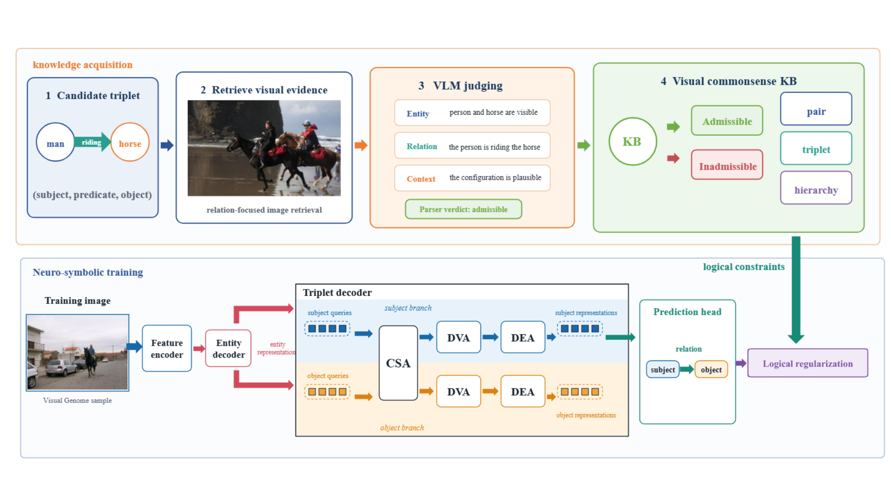

# NeSySGG

**Scaling Neuro-Symbolic Scene Graph Generation with Visually Grounded Commonsense Knowledge**

This repository hosts the codes of the paper. 

---

## Architecture

**Overview of the proposed approach.** The offline pipeline grounds each candidate VG150 configuration with predicate-specific images, obtains a structured VLM verdict, and projects the resulting knowledge into Pair, Triplet, and hierarchical constraints. The constraints provide differentiable supervision only during training; inference retains the original RelTR path.

The pipeline consists of two stages:

1. **Knowledge acquisition (offline).** Over the VG150 candidate space `subject × predicate × object`, predicate-specific visual evidence is retrieved and a vision-language model (VLM) verifies entity validity, relation semantics, and visual plausibility in three stages. Each candidate is judged `admissible` or `inadmissible` and written into a visual commonsense knowledge base.
2. **Neuro-symbolic training.** The knowledge base is projected into Pair, Triplet, and hierarchical class constraints, which serve as a differentiable logical objective (LTN / logLTN / FocalLTN) alongside the RelTR training loss. The VLM is used only offline, and inference follows the original RelTR path unchanged.

---

## Abstract

Scene graph generation (SGG) converts an image into a structured representation of objects and their relations, but its supervision is dominated by frequent predicates and omits many valid relations. Logic Tensor Networks (LTNs) can complement visual supervision with semantic constraints, yet manually defining such constraints does not scale to the more than one million possible subject, predicate, and object configurations in VG150. We present a neuro-symbolic SGG framework that automatically acquires visually grounded commonsense knowledge from this configuration space and integrates the resulting constraints into RelTR during training. For each candidate configuration, predicate-specific Visual Genome examples guide a three-stage vision-language analysis of entity validity, relation semantics, and visual plausibility. The retained decisions are represented as Pair constraints that capture predicate domains and ranges, configuration-specific Triplet constraints, and hierarchical class constraints. We evaluate our approach on SGDet under a class aware low data protocol using 20% of the VG150 training split. Pair logLTN increases R@100 from 12.7% to 15.4% and mR@100 from 4.0% to 5.2%, while Pair FocalLTN achieves the highest mR@100 of 5.6%. Across all matched logical formulations, Pair constraints consistently outperform the Triplet counterparts in R@100, mR@100, and object detection mAP@50. These results indicate that when automatically acquired knowledge is incomplete, reusable predicate domain and range constraints provide more effective supervision than configuration-specific Triplet rules.

**Keywords:** Scene graph generation, neuro-symbolic learning, Logic Tensor Networks, visual commonsense, vision-language models

## Paper

The link of the paper will be updated after the paper is published.

## Citation

If you find UCS-Bench or DirectMe useful, please cite our work:

The bibtex will be updated after the paper is published.

